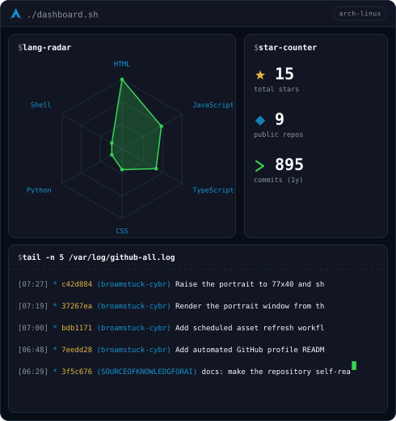
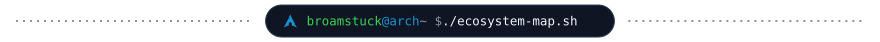
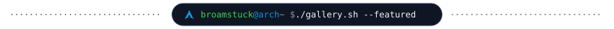
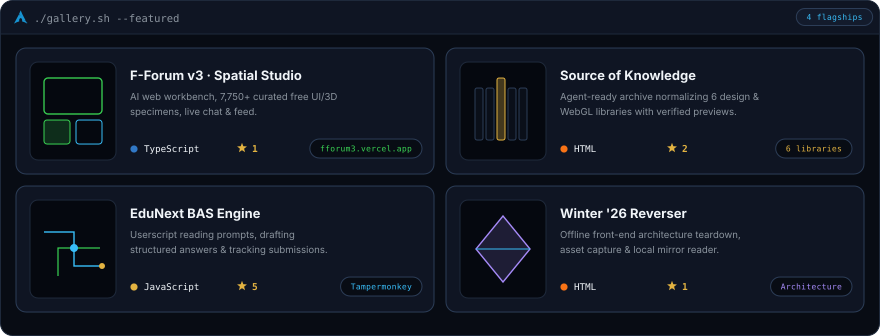

 

<table width="100%" border="0" cellspacing="0" cellpadding="0">
  <tr>
    <td width="50%" align="center" valign="top">
      
    </td>
    <td width="50%" align="center" valign="top">
      
    </td>
  </tr>
</table>

 

[F-Forum v3](https://github.com/broamstuck-cybr/f_forumv3) (`fforum3.vercel.app`) · [SOURCEOFKNOWLEDGFORAI](https://github.com/broamstuck-cybr/SOURCEOFKNOWLEDGFORAI) · [EduNext BAS](https://github.com/broamstuck-cybr/Edunext_fe) · [Winter '26 Reverser](https://github.com/broamstuck-cybr/shoptify-winter-reverser-engine) · [F-Forum v1](https://github.com/broamstuck-cybr/f-forum)

 

