  &nbsp;&nbsp;

  <a href="https://broamstuck-cybr.github.io/broamstuck-cybr/"><strong>Launch Interactive Liquid-Sky, 5D Radar &amp; 360&deg; 3D Observatory</strong></a>
  &nbsp;&middot;&nbsp;
  <a href="https://fforum3.vercel.app">F-Forum v3 Live</a>
  &nbsp;&middot;&nbsp;
  <a href="https://github.com/broamstuck-cybr/F-Forum_v2">F-Forum v2 Bridge</a>
  &nbsp;&middot;&nbsp;
  <a href="https://f-forum.vercel.app">F-Forum v1 Live</a>

